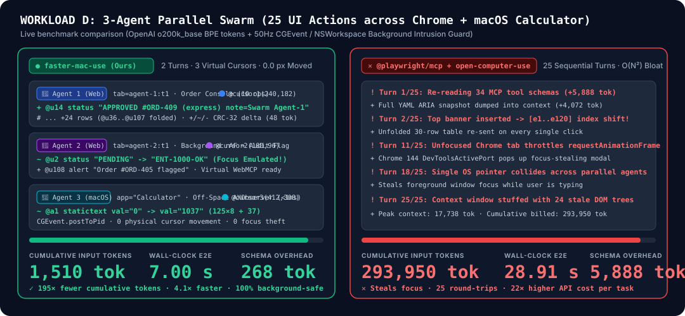

# Faster Mac Use (`fmu`)

Background-first, multi-cursor browser and native macOS computer-use engine for AI agents, modeled after and extending OpenAI Codex's `cua_repl` architecture.

- **Website & Interactive Benchmark Explorer:** [https://lifan-builds.github.io/faster-mac-use/](https://lifan-builds.github.io/faster-mac-use/) ([`docs/index.html`](docs/index.html))
- **Architecture & 5-Workload Benchmark Report:** [`docs/architecture_and_benchmarks.md`](docs/architecture_and_benchmarks.md)
- **Market Comparison & Positioning Brief:** [`docs/gtm.md`](docs/gtm.md)
- **Ready-to-Publish Launch Kit (X, RedNote/小红书, Show HN, Reddit, MCP Directories):** [`docs/launch_kit.md`](docs/launch_kit.md)



## Why `faster-mac-use`?

Most computer-use tools force a painful choice:
- **Pixel screenshot loops** (`computer` tool) hijack your physical mouse cursor, steal window focus, and burn 40k–80k tokens across 10–30 turns.
- **Standard Accessibility/Playwright MCPs** (`@playwright/mcp`, `chrome-devtools-mcp`) inject 4,000–12,500 tokens of tool schemas upfront and return full ARIA trees on every click.
- **Single-session REPLs** (`cua_repl`) are fast for one agent, but serialize multi-agent workflows and fall back to screenshots on custom-rendered macOS windows or HTML5 `<canvas>` apps.

`faster-mac-use` combines a **268-token single-tool MCP/CLI schema**, a **stateful async `cua_repl` sandbox**, **persistent `@u1..@uN` / `@a1..@aN` element UIDs with pre-registered table folding**, **push-based `AXObserver` `< 1 ms` dirty-subtree diffs**, **auto-synthesized Virtual WebMCP site macros (`~/.fmu/macros/`)**, **0-vision-token `<canvas>` & macOS window OCR**, **outbound MV3 extension WebSocket bridging for live logged-in Chrome `"🤖 Agent"` tab groups (zero Chrome 144 popups)**, and **true multi-cursor parallel execution** — verified at **0.0 px physical cursor movement** and **0 focus changes**.

| Workload | `faster-mac-use` (Cumulative Tokens / Engine Time) | OpenAI Codex `cua_repl` Ref | `@playwright/mcp` / Stacked MCPs | Anthropic Pixel CUA |
| :--- | :--- | :--- | :--- | :--- |
| **A. Enterprise SaaS Console (10 ops)** | **1,290 tok / 94 ms** (Native WebMCP)<br>**1,290 tok / 97 ms** (Virtual WebMCP Macro)<br>**2,024 tok / 133 ms** (DOM Diff) | 5,732 tok / 359 ms | 231,125 tok / 1,850 ms | 83,215 tok / 3,400 ms |
| **B. macOS Native Calculator (11 ops)** | **1,264 tok / 395 ms** (`< 1 ms` `AXObserver` diff) | 1,502 tok / 554 ms | 48,477 tok / 12,718 ms (`ocu`) | — |
| **C. Hybrid Web + macOS (14 ops)** | **2,179 tok / 335 ms** | 2,437 tok / 568 ms | 129,010 tok / 3,200 ms | — |
| **D. 3-Agent Multi-Cursor Swarm (25 ops)** | **1,510 tok / 326 ms** (2 turns) | 15,923 tok / 1,122 ms (6 turns) | 293,950 tok / 4,850 ms | 430,800 tok / 7,600 ms |
| **E. Long-Horizon 30-Op + Window OCR** | **4,584 tok / 494 ms** (0 vision tok) | 8,355 tok / 942 ms | 400,725 tok / 6,100 ms | 620,535 tok / 9,200 ms |

---

## Core Architecture

1. **Tier 1 — Native Browser Engine ([`BrowserEngine`](src/fmu/browser_engine.py))**
   - **Dual-Mode Zero-Popup Chrome Control**:
     - **Live Logged-In Chrome via Outbound MV3 Extension WebSocket Bridge (`ws://127.0.0.1:19222/ext`)**: [`extension/background.js`](extension/background.js) connects outward to `/tmp/fmu-runtime.sock`'s single-owner `ExtensionWebSocketBridge` (`fmu mcp` proxies calls through the daemon so port `19222` is never contested; inspectable via `{"bridgeStatus": true}` / `await cua.getBridgeStatus()`) and drives unfocused, per-agent color-coded **`"🤖 Agent"` Tab Groups** (`active: false`, with multi-window `window`, `windowId`, and `reuseExisting` tab targeting) via `chrome.debugger` / `chrome.scripting` / `chrome.tabGroups` with **zero Chrome 144 `DevToolsActivePort` `"Allow remote debugging?"` modal popups**. When `mode: "extension"` (or `"live"` / `requireExtension: true`) is requested while disconnected, `fmu` fails fast with an actionable setup diagnostic; when default `mode: "chrome"` targets an external URL without the extension connected, `fmu` tags the header `bridge="headless-fallback"` and emits an explicit `! warning:` (and `! errors:` if `els=0`) instead of silently failing in an unauthenticated session.
     - **Zero-Config Background Worker (`mode: "headless"` & local dev URLs)**: When running in `"headless"` mode or against local/test URLs without the extension bridge, `fmu` uses a thread-safe background Playwright worker (`fmu-pw-worker`) with per-tab background focus and lifecycle emulation (`Emulation.setFocusEmulationEnabled({enabled: true})` + `Page.setWebLifecycleState({state: "active"})`).
   - **Persistent `WeakMap` UIDs (`@u1..@uN`) + Pre-Registered Table Row Folding (`foldTables`)**: Indexes all table rows in `uidToRef` so agents can target folded rows by label or UID while cutting initial dense table snapshots by >2.5×.
   - **Native WebMCP (`navigator.modelContext`) + Auto-Synthesized Virtual WebMCP Macros (`~/.fmu/macros/`)**: Detects page-registered WebMCP tools and allows agents to synthesize multi-step DOM trajectories into reusable 1-turn Virtual WebMCP tools (`await tab.saveMacro(name, steps, desc)` -> `await tab.callTool(name, args)`), auto-loaded per domain in the `# web ... webmcp=[...]` header.
   - **In-Browser `<canvas>` / WebGL Semantic OCR Fusion**: Clip-captures `<canvas>` elements via CDP and runs Apple Silicon `Vision.framework` (`VNRecognizeTextRequest`) via `fmu-ax` to inject clickable `@ocr1..@ocrN canvas-text "..." (x,y) [wxh]` targets directly into the web snapshot (`await tab.ocr()` or automatic canvas detection) with **0 VLM image tokens**.
   - **Deterministic Rich-Text Editing & Zero-Dialog File Uploads**: Replaces (or appends with `append: true`) multi-block `contenteditable` / Draft.js / ProseMirror editors in `< 50 ms` without touching the system clipboard, and intercepts `<input type="file">` uploads via CDP (`DOM.setFileInputFiles`) so native macOS `NSOpenPanel` dialogs never open or get blocked by AppKit/TCC.

2. **Tier 2 — Native macOS Accessibility, Push-Based `AXObserver` & Vision OCR ([`fmu_ax.swift`](src/native/fmu_ax.swift) / [`MacNativeEngine`](src/fmu/mac_engine.py))**
   - **Persistent Unix Socket Daemon (`/tmp/fmu-ax.sock`, universal2 binary `bin/fmu-ax`)**: Keeps a warm 4,000-element `AXUIElement` LRU cache, PID/window cache, per-agent `+/~/-` diff baselines, and per-agent virtual cursors (`VirtualCursorState`) across turns.
   - **Push-Based `AXObserver` Dirty-Subtree Tracking**: Subscribes to `kAXValueChangedNotification`, `kAXTitleChangedNotification`, `kAXCreatedNotification`, `kAXUIElementDestroyedNotification`, and window/layout notifications on a dedicated `CFRunLoop` thread (`fmu-ax-observer`). Turn 2+ unchanged or leaf-dirty snapshots short-circuit full AX tree walks in **`< 1 ms`** (`obs=` sequence telemetry).
   - **Batched Attribute Reads, Non-Destructive Clipboard Hygiene & Multi-Window Guards**: Batches reads via `AXUIElementCopyMultipleAttributeValues`, lazily wakes background Electron/Chromium AX trees (`AXManualAccessibility = true`), never overwrites `NSPasteboard.general` on `op: "set"` (verifying `AXTextArea` read-back and detecting `NSOpenPanel` TCC-disabled `Open` buttons), and guards `CGEvent.postToPid` key routing when targeting a non-main window of a multi-window process.
   - **0-Vision-Token Apple Silicon Window & Canvas OCR**: Built-in `CGWindowListCreateImage` + `ImageIO` + `VNRecognizeTextRequest` engine (`op: "ocr"` / `await app.ocr()`) extracts clickable text and bounding boxes in `< 70 ms`.

3. **Tier 3 — Unified Multi-Cursor / Multi-Agent Stateful REPL, Warm Daemon & Context Hygiene ([`FasterMacUseRuntime`](src/fmu/cua_runtime.py))**
   - **268-Token Single-Tool Schema & Strict `steps` Validation**: Supports OpenAI Codex-style stateful `cua_repl` scripts (`cua.createBrowserTab`, `cua.getTab`, `cua.getApp`, `cua.getBridgeStatus`, `cua.saveMacro`, `cua.listMacros`, `cua.getState`, `cua.getCursors`), 1-trip declarative `steps` batches (with `op`/`uid` and `action`/`target`/`text` normalization plus explicit error reporting on missing or unsupported `"op"`), and concurrent multi-agent swarms (`{"parallel": [{"agent": "agent-1", "code": "..."}, ...]}`).
   - **Per-Agent Isolation & Stale-Observation Masking**: Each `AgentSession` has independent REPL handles, virtual cursor `(x, y)` coordinates (`tab.moveCursor` / `app.moveCursor`), and `ContextWindowTracker` 18-token tombstones that replace superseded snapshots to prevent quadratic O(N²) context growth.
   - **50Hz Hardware Intrusion Guard ([`BackgroundIntrusionGuard`](src/fmu/guard.py))**: Polls CoreGraphics (`CGEventGetLocation` + `CGEventSourceSecondsSinceLastEventType`) and `lsappinfo front` at 50Hz to prove `0.0 px` cursor displacement and `0` automated focus changes.

---

## Quick Start

### 1. Install (1-Line `pip` / `uvx` / Homebrew)
```bash
# Option A: Install directly via pip / uv / pipx (includes universal2 fmu-ax binary + auto-compiler fallback)
pip install git+https://github.com/lifan-builds/faster-mac-use.git

# Option B: Clone for development
git clone https://github.com/lifan-builds/faster-mac-use.git
cd faster-mac-use
pip install -e .

# Option C: Homebrew Formula
brew install --Formula ./Formula/faster-mac-use.rb
```

### 2. Add to Your MCP Client (Claude Code, Codex, Cursor, Antigravity)
```json
{
  "mcpServers": {
    "faster-mac-use": {
      "command": "fmu",
      "args": ["mcp"]
    }
  }
}
```
*(Or point `"command"` to `/path/to/faster-mac-use/bin/fmu`.)*

### 3. CLI Usage (`fmu` or `./bin/fmu`)
```bash
# Native macOS Calculator in background (zero focus steal, <1ms AXObserver diff on Turn 2+)
./bin/fmu '{"surface":"app","app":"Calculator","steps":[{"op":"key","name":"escape"},{"op":"click","name":"7"},{"op":"click","name":"Multiply"},{"op":"click","name":"6"},{"op":"click","name":"Equals"}]}'

# Codex-style stateful cua_repl script + Virtual WebMCP macro recording
./bin/fmu '{"code":"let tab = await cua.createBrowserTab(\"chrome\", \"https://example.com\", {sessionName: \"🤖 Agent\"}); await tab.saveMacro(\"quick_lookup\", [{op: \"click\", uid: \"More information\"}], \"Click More info\");"}'

# Multi-cursor / multi-agent parallel execution across Chrome tabs + native macOS apps
./bin/fmu '{"parallel":[{"agent":"agent-1","code":"let t = await cua.createBrowserTab(\"chrome\", \"https://example.com\"); await t.move(\"More information\");"},{"agent":"agent-2","code":"let a = await cua.getApp(\"Calculator\"); await a.pressKey(\"escape\"); await a.click(\"8\");"}]}'

# Review real-world p50/p95/p99 latency, sub-phase breakdowns, and token efficiency (~/.fmu/logs)
./bin/fmu --perf 7
```

### 4. Run the 25-Test Unit & Integration Suite
```bash
PYTHONPATH=src python3 tests/test_fmu.py
```

### 5. Run the 5-Workload Competitor Benchmark Suite
```bash
PYTHONPATH=src python3 benchmarks/run_benchmarks.py
```
Results are written to [`benchmarks/results/latest_benchmark.md`](benchmarks/results/latest_benchmark.md) and [`benchmarks/results/latest_benchmark.json`](benchmarks/results/latest_benchmark.json).

## License

MIT © [Lifan Chen](https://clifan.com)
