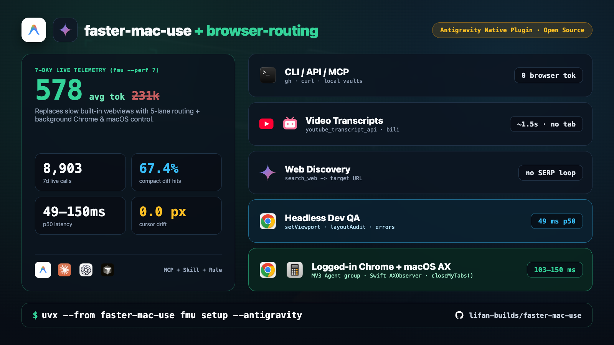
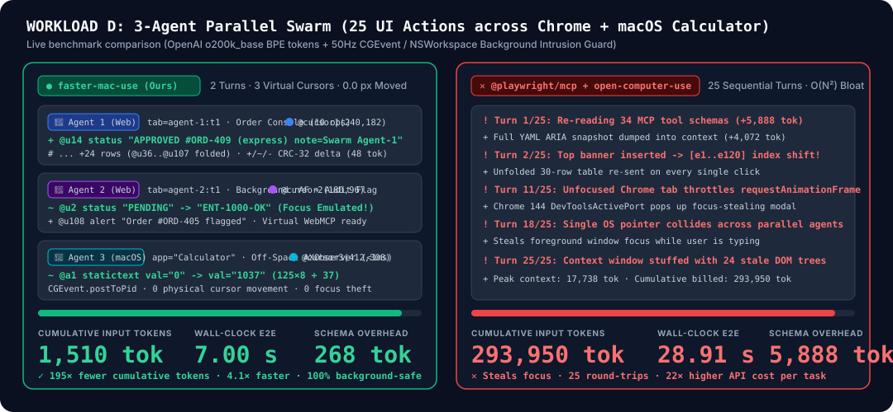

# Faster Mac Use (`fmu`)

[中文说明 (README_ZH.md)](README_ZH.md)

[](https://pypi.org/project/faster-mac-use/) [](https://pypi.org/project/faster-mac-use/) [](https://github.com/lifan-builds/faster-mac-use/stargazers) [](https://glama.ai/mcp/servers/lifan-builds/faster-mac-use)  

`fmu` lets AI agents drive your logged-in Chrome tabs and native macOS apps in the background — now bundled with the **[`browser-routing` skill](.agents/skills/browser-routing/SKILL.md)** and a **one-command Antigravity plugin**. Your mouse stays where you left it (`0.0 px` drift), your active window keeps focus, Chrome 144 shows zero remote-debugging popups, and each step returns a few hundred tokens of `+`/`~`/`-` `@uid` text diffs instead of a screenshot.

> **Highly recommended for Antigravity users:** Antigravity's built-in computer-use / browser subagent runs inside a slow, isolated webview that cannot share your logged-in Chrome sessions. Installing the `faster-mac-use` + `browser-routing` bundle wires the MCP engine, the 5-lane routing skill, and an always-on routing rule as a single native Antigravity plugin — turning real-world browser and macOS interaction into sub-150 ms background calls.



## Quickstart (Engine + `browser-routing` Skill Bundle)

### 1. Antigravity (Recommended — 1-command native plugin)

Installs the complete Antigravity plugin to `~/.gemini/config/plugins/faster-mac-use/` (`faster-mac-use` MCP + `browser-routing` skill + always-on routing rule; loads live on the next turn without touching `config.json`):

```bash
uvx --from faster-mac-use fmu setup --antigravity
```

### 2. Claude Code, Codex, or Cursor

Install the bundled `browser-routing` skill and register the MCP server:

```bash
# Install skill into ~/.agents/skills + detected harnesses (--claude, --codex, --cursor, --all)
uvx --from faster-mac-use fmu setup --all

# Register MCP server
claude mcp add faster-mac-use -- uvx --from faster-mac-use fmu mcp
codex mcp add faster-mac-use -- uvx --from faster-mac-use fmu mcp
```

Or drop it into any MCP client config (and copy [`.agents/skills/browser-routing/SKILL.md`](.agents/skills/browser-routing/SKILL.md) into your skills folder):

```json
{
  "mcpServers": {
    "faster-mac-use": { "command": "uvx", "args": ["--from", "faster-mac-use", "fmu", "mcp"] }
  }
}
```

### 3. Try it right now in 5 seconds (zero install, zero focus change)

Run `7 × 6 =` in macOS Calculator in the background with [`uv`](https://docs.astral.sh/uv/):

```bash
uvx --from faster-mac-use fmu '{
  "surface": "app",
  "app": "Calculator",
  "steps": [
    {"op": "key", "name": "escape"},
    {"op": "click", "name": "7"},
    {"op": "click", "name": "Multiply"},
    {"op": "click", "name": "6"},
    {"op": "click", "name": "Equals"}
  ]
}'
```

Installing from `uvx` or PyPI? [Star `lifan-builds/faster-mac-use` on GitHub](https://github.com/lifan-builds/faster-mac-use) to follow releases and help other Mac & Antigravity builders find it.

## Why Bundle `faster-mac-use` + `browser-routing`?

Shipping a fast MCP engine alone is only half the harness. Without a routing skill, agents still fall back to slow built-in browser subagents, launch a full browser just to read a YouTube transcript or search Google, insert blind `wait(3000)` sleeps, re-read full DOM dumps instead of `.diff()`, and leave orphan tabs behind.

Pairing **`faster-mac-use`** (the engine) with **[`browser-routing`](.agents/skills/browser-routing/SKILL.md)** (the routing contract) fixes both sides:

| Task | Route chosen by `browser-routing` | Typical speed / footprint |
| --- | --- | --- |
| **APIs, Git, structured data** | Native CLI / API / MCP connector (`gh`, `curl`, local MCPs) | `0` browser tokens |
| **YouTube & Bilibili videos** | `youtube_transcript_api` + oEmbed / `yt-dlp --skip-download` | `~1.5s`, zero browser tab |
| **Public web discovery** | Native `search_web` first, open only the chosen target URL | Zero SERP clicking |
| **Public / localhost dev QA** | `fmu` headless + `setViewport()` + `layoutAudit()` + `errors()` | **`49 ms` p50** (field) |
| **Logged-in Chrome & extensions** | `fmu` MV3 bridge (`ws://127.0.0.1:19222/ext`) in `"Agent"` tab groups | **`145 ms` p50** (field) |
| **Native macOS apps & `<canvas>`** | `fmu` Swift `AXObserver` daemon + Apple Silicon `Vision.framework` OCR | **`103 ms` p50**, `0` vision tokens |

### 7-Day Real-World Production Telemetry (`fmu --perf 7`)

Measured across **8,460 live calls** in daily Antigravity usage (not synthetic toy prompts):
- **Average tokens/call:** **`576.1` tokens** (`p95 = 1,848`), with **`67.0%` compact diff / unchanged hits** (`3,728` unchanged + `1,904` diffs vs `2,777` snapshots).
- **Median latency by surface:** **`48.8 ms`** headless (`1,182` calls) · **`103.5 ms`** native macOS AX (`845` calls) · **`144.5 ms`** logged-in Chrome MV3 (`6,387` calls).
- **Batched execution:** `7,697` stateful REPL turns + `457` parallel multi-cursor calls + `501` cached strict-CSP escalations.

## Benchmarks

Cumulative input tokens and engine time across five workloads. Raw JSON, per-turn traces, and the runner live in [`benchmarks/`](https://github.com/lifan-builds/faster-mac-use/tree/main/benchmarks) and the [benchmark report](https://github.com/lifan-builds/faster-mac-use/blob/main/docs/architecture_and_benchmarks.md); rerun them locally with `PYTHONPATH=src python3 benchmarks/run_benchmarks.py` or inspect every turn in the [interactive benchmark explorer](https://clifan.com/faster-mac-use/).



| Workload | `faster-mac-use` (Cumulative Tokens / Engine Time) | OpenAI Codex `cua_repl` Ref | `@playwright/mcp` / Stacked MCPs | Anthropic Pixel CUA |
| :--- | :--- | :--- | :--- | :--- |
| **A. Enterprise SaaS Console (10 ops)** | **1,290 tok / 94 ms** (Native WebMCP)<br>**1,290 tok / 97 ms** (Virtual WebMCP Macro)<br>**2,024 tok / 133 ms** (DOM Diff) | 5,732 tok / 359 ms | 231,125 tok / 1,850 ms | 83,215 tok / 3,400 ms |
| **B. macOS Native Calculator (11 ops)** | **1,264 tok / 395 ms** (`< 1 ms` `AXObserver` diff) | 1,502 tok / 554 ms | 48,477 tok / 12,718 ms (`ocu`) | n/a |
| **C. Hybrid Web + macOS (14 ops)** | **2,179 tok / 335 ms** | 2,437 tok / 568 ms | 129,010 tok / 3,200 ms | n/a |
| **D. 3-Agent Multi-Cursor Swarm (25 ops)** | **1,510 tok / 326 ms** (2 turns) | 15,923 tok / 1,122 ms (6 turns) | 293,950 tok / 4,850 ms | 430,800 tok / 7,600 ms |
| **E. Long-Horizon 30-Op + Window OCR** | **4,584 tok / 494 ms** (0 vision tok) | 8,355 tok / 942 ms | 400,725 tok / 6,100 ms | 620,535 tok / 9,200 ms |

During benchmark runs, [`BackgroundIntrusionGuard`](https://github.com/lifan-builds/faster-mac-use/blob/main/src/fmu/guard.py) polls CoreGraphics cursor coordinates and `lsappinfo front` at 50 Hz and verifies `0.0 px` of cursor movement and `0` focus changes.

## Replay what your agent did

Set `FMU_TRACE` to record any CLI or MCP session, then render a self-contained HTML player or looping SVG for pull requests and bug reports. Each frame draws `@u`/`@a` element bounds, colors added, changed, and removed elements, and shows per-step latency and token counts.

```bash
export FMU_TRACE=~/fmu-run.jsonl
# ... let your agent work ...
fmu replay ~/fmu-run.jsonl              # -> ~/fmu-run.html (left/right arrows to step, space to play)
fmu replay ~/fmu-run.jsonl -o run.svg   # looping animated SVG
fmu replay ~/.fmu/logs/perf-2026-11-26.jsonl   # perf logs render as a latency timeline
```



## How `faster-mac-use` works

- **Logged-in Chrome without popups ([`browser_engine.py`](https://github.com/lifan-builds/faster-mac-use/blob/main/src/fmu/browser_engine.py), [`extension/background.js`](https://github.com/lifan-builds/faster-mac-use/blob/main/extension/background.js))**: An outbound MV3 extension bridge (`ws://127.0.0.1:19222/ext`) drives unfocused tabs inside per-session `"Agent"` tab groups without triggering Chrome 144 `DevToolsActivePort` modal prompts. For public or local dev pages, `mode: "headless"` runs in a background Playwright worker with focus and lifecycle emulation. Agents can also list and toggle Chrome extensions (`cua.listExtensions()`, `cua.setExtensionEnabled()`), fill cross-origin payment/auth iframes via trusted CDP input, edit rich-text `contenteditable` surfaces without touching the clipboard, and upload files via `DOM.setFileInputFiles` without opening `NSOpenPanel`.
- **Sub-millisecond macOS Accessibility & 0-vision-token OCR ([`fmu_ax.swift`](https://github.com/lifan-builds/faster-mac-use/blob/main/src/fmu/native/fmu_ax.swift), [`mac_engine.py`](https://github.com/lifan-builds/faster-mac-use/blob/main/src/fmu/mac_engine.py))**: A warm universal2 Swift daemon (`/tmp/fmu-ax.sock`) caches `AXUIElement` handles and subscribes to `AXObserver` dirty-subtree notifications on a dedicated `CFRunLoop` thread so follow-up diffs return in under 1 ms. Built-in Apple Silicon `Vision.framework` OCR (`await tab.ocr()`, `await app.ocr()`) turns `<canvas>` and custom window text into clickable `@ocr1..@ocrN` targets at zero image tokens, alongside an optional non-activating floating Live View PiP monitor and menu bar `Stop` / `Resume` (`fmu --live-view on|off`, `fmu --stop`).
- **Stateful Python/JS REPL, WebMCP macros & context compaction ([`cua_runtime.py`](https://github.com/lifan-builds/faster-mac-use/blob/main/src/fmu/cua_runtime.py))**: Exposes a single `cua` MCP tool (`268`-token schema) supporting stateful REPL scripts (`cua.createBrowserTab`, `cua.getTab`, `cua.getApp`), declarative `steps` batches, reusable per-domain Virtual WebMCP macros (`~/.fmu/macros/`), concurrent swarms (`{"parallel": [...]}`), and 18-token tombstones that mask superseded snapshots so long runs stay linear in tokens.

## Install and CLI usage

Install `fmu` permanently with `uv`, `pip`, or Homebrew (first macOS run compiles the universal2 `fmu-ax` helper automatically):

```bash
uv tool install faster-mac-use      # or: pip install faster-mac-use
# From source: git clone https://github.com/lifan-builds/faster-mac-use.git && cd faster-mac-use && pip install -e .
# Homebrew:    brew install --Formula ./Formula/faster-mac-use.rb
```

Once installed globally, you can run `fmu setup --antigravity --use-installed-bin` or invoke `fmu` directly from the shell:

```bash
# Stateful cua REPL: open a tab, record a reusable WebMCP macro, and close agent-opened tabs when done
fmu '{"code":"tab = cua.createBrowserTab(\"chrome\", \"https://example.com\", sessionLabel=\"Docs\"); tab.saveMacro(\"more_info\", [{\"op\": \"click\", \"uid\": \"More information\"}], \"Open More info\"); cua.closeMyTabs()"}'

# Multi-cursor parallel execution across Chrome tabs and native macOS apps
fmu '{"parallel":[{"agent":"web-1","code":"t = cua.createBrowserTab(\"headless\", \"https://example.com\"); t.move(\"More information\")"},{"agent":"mac-1","code":"a = cua.getApp(\"Calculator\"); a.pressKey(\"escape\").click(\"8\")"}]}'

# Inspect 7-day p50/p95/p99 latency, sub-phase breakdowns, and token telemetry (~/.fmu/logs)
fmu --perf 7
```

### Multiple agents on one Mac

The warm daemon reads each caller's PID over the Unix socket (`LOCAL_PEERPID`) and walks up to the owning harness (Antigravity, Claude Code, Codex, Devin, Gemini, Cursor):
- **Isolated tab namespaces and groups**: Sessions get distinct IDs (`devin1:t1`, `codex1:t1`) and color-coded Chrome tab groups titled `Harness · project` (or `sessionLabel` when passed from multi-conversation MCP hosts).
- **Safe tab cleanup**: `cua.closeMyTabs({keep: [...]})` and `{"closeAgentTabs": true}` close only tabs opened by that session. Calling `tab.close()` on a user-opened tab detaches without closing the user's tab unless `force=True` is passed.

### Platform scope & tests

- Native `fmu-ax` accessibility and `Vision.framework` OCR require macOS (Apple Silicon / macOS 14+ recommended) and Accessibility permission.
- Driving logged-in Chrome tabs without `DevToolsActivePort` modals uses the bundled unpacked MV3 extension (`extension/`); headless mode works without the extension.

```bash
python3 tests/test_fmu.py
PYTHONPATH=src python3 benchmarks/run_benchmarks.py
```

## License

Open source under [AGPL-3.0-only](https://github.com/lifan-builds/faster-mac-use/blob/main/LICENSE), with the Section 7 attribution terms in [ATTRIBUTION.md](https://github.com/lifan-builds/faster-mac-use/blob/main/ATTRIBUTION.md). Copies and modified versions must keep this credit in their README and `--version` or About output, mark their changes, and may not use the Faster Mac Use name:

> Based on Faster Mac Use by lifan-builds (https://github.com/lifan-builds/faster-mac-use)

Copyright © 2026 [lifan-builds](https://github.com/lifan-builds). Pull requests are welcome under [CONTRIBUTING.md](https://github.com/lifan-builds/faster-mac-use/blob/main/CONTRIBUTING.md) with a one-time [CLA](https://github.com/lifan-builds/faster-mac-use/blob/main/CLA.md). For licensing outside AGPL, open an issue.

<!-- mcp-name: io.github.lifan-builds/faster-mac-use -->
