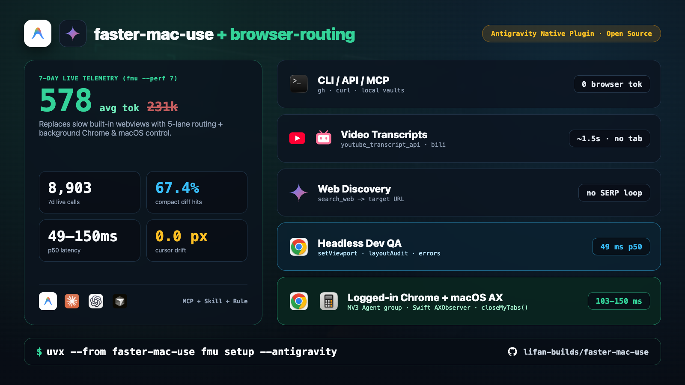

# Faster Mac Use (`fmu`) + `browser-routing` 技能包

[English README](README.md)

[](https://pypi.org/project/faster-mac-use/) [](https://pypi.org/project/faster-mac-use/) [](https://github.com/lifan-builds/faster-mac-use/stargazers) [](https://glama.ai/mcp/servers/lifan-builds/faster-mac-use)

`faster-mac-use` (`fmu`) 是一个面向 macOS 的后台多光标浏览器与原生应用控制引擎，现已直接捆绑 **[`browser-routing` 路由技能](.agents/skills/browser-routing/SKILL.md)** 和 **Antigravity 一键原生插件**。Agent 在 Chrome 后台 `"Agent"` 标签组和原生 Mac 软件里并行操作时，你的物理鼠标纹丝不动（`0.0 px` 偏移）、当前窗口不丢焦点、Chrome 144 无远程调试弹窗，每步返回几百 token 的 `+/~/-` `@uid` 增量 diff，而不是整张截图或几十万 token 的完整 DOM 树。

> **强烈推荐给 Antigravity 用户：** Antigravity 内置的电脑/浏览器子代理跑在独立的沙盒 webview 里，既偏慢又没法复用你平时已登录的 Chrome 标签页。用这一套 `faster-mac-use` + `browser-routing` 打包插件，一条命令就能把 MCP 引擎、五通道路由技能和常驻路由规则一起装进 Antigravity，让它默认走高速后台通道，彻底告别笨重的内置浏览器子代理。



## 一行安装（也可以直接把本仓库链接丢给你的 AI 客户端帮你装）

### 1. Antigravity 用户（推荐：一键原生插件）

自动把 `faster-mac-use` MCP + `browser-routing` 技能 + 常驻路由规则装到 `~/.gemini/config/plugins/faster-mac-use/`（不改 `config.json`，下一轮对话自动生效）：

```bash
uvx --from faster-mac-use fmu setup --antigravity
```

### 2. Claude Code / Codex / Cursor 用户

```bash
# 安装 browser-routing 技能到 ~/.agents/skills 以及已检测到的客户端目录
uvx --from faster-mac-use fmu setup --all

# 注册 MCP 服务
claude mcp add faster-mac-use -- uvx --from faster-mac-use fmu mcp
codex mcp add faster-mac-use -- uvx --from faster-mac-use fmu mcp
```

### 3. 五秒体验（不抢焦点、零安装）

直接在后台用 macOS 计算器算 `7 × 6 =`：

```bash
uvx --from faster-mac-use fmu '{
  "surface": "app",
  "app": "Calculator",
  "steps": [
    {"op": "key", "name": "escape"},
    {"op": "click", "name": "7"},
    {"op": "click", "name": "Multiply"},
    {"op": "click", "name": "6"},
    {"op": "click", "name": "Equals"}
  ]
}'
```

## 为什么要把 `faster-mac-use` 和 `browser-routing` 打包在一起？

光装一个快引擎往往不够：没有路由技能约束时，Agent 还是会习惯性去调内置的慢速浏览器子代理，或者看个 YouTube 字幕也要开网页、每点一下塞一个 `wait(3000)`、每步重读整棵 DOM 树、跑完留一屏幕孤儿标签页。

把 **`faster-mac-use`（执行引擎）** 和 **[`browser-routing`](.agents/skills/browser-routing/SKILL.md)（调度大脑）** 绑在一起后，每类真实交互都能直接走最快通道：

| 任务类型 | `browser-routing` 路由去向 | 实测速度 / 开销 |
| --- | --- | --- |
| **结构化数据 / Git / 接口** | 优先 CLI / API / 本地 MCP（`gh`、`curl` 等） | `0` 浏览器 token |
| **YouTube / B站 视频内容** | `youtube_transcript_api` + oEmbed / `yt-dlp --skip-download` | 约 `1.5s`，不开网页 |
| **公开信息检索** | 先用内置 `search_web`，只打开选中的目标页 | 不在搜索结果页瞎点 |
| **公开页 / 本地前端调试 QA** | `fmu` headless + `setViewport()` + `layoutAudit()` + `errors()` | **`49 ms` p50**（实测） |
| **已登录 Chrome / 扩展管理** | `fmu` MV3 扩展桥接（`ws://127.0.0.1:19222/ext`）后台标签组 | **`145 ms` p50**（实测） |
| **原生 Mac 应用与 `<canvas>`** | Swift `AXObserver` 守护进程 + Apple Silicon `Vision` 本地 OCR | **`103 ms` p50**，`0` 视觉 token |

### 7 天真实生产遥测（`fmu --perf 7`）

来自日常 Antigravity 高强度使用的 **8,460 次真实调用**（非玩具 benchmark）：
- **平均单次消耗 `576.1` tokens**（`p95 = 1,848`），**`67.0%` 命中紧凑 diff / unchanged**（`3,728` 次未变化 + `1,904` 次增量 diff）。
- **分通道中位延迟：** headless **`48.8 ms`**（`1,182` 次） · 原生 macOS AX **`103.5 ms`**（`845` 次） · 已登录 Chrome MV3 **`144.5 ms`**（`6,387` 次）。
- **单回合批量执行：** `7,697` 次有状态 REPL 链式调用 + `457` 次多光标并行调用 + `501` 次严格 CSP 缓存直通。

## 局限说明

- 原生 Swift `AXObserver` 和 Apple Silicon `Vision.framework` OCR 仅支持 macOS（需要给终端开辅助功能权限）。
- 操控已登录 Chrome 后台标签页需要加载仓库内附带的本地未打包 MV3 扩展（`extension/`）；无头模式 `headless` 无需扩展即可直接跑。

## 社区与开源协议

感谢 [LINUX DO](https://linux.do) 社区的开源氛围与技术交流支持。

本项目基于 [AGPL-3.0-only](LICENSE) 开源，并附带 [ATTRIBUTION.md](ATTRIBUTION.md) 中的 Section 7 署名条款；向本仓库提交 PR 需一次性签署 [CLA](CLA.md)。觉得顺手的话，欢迎点个 Star 支持一下。
